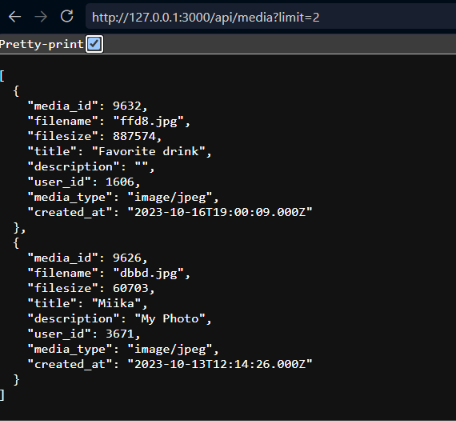
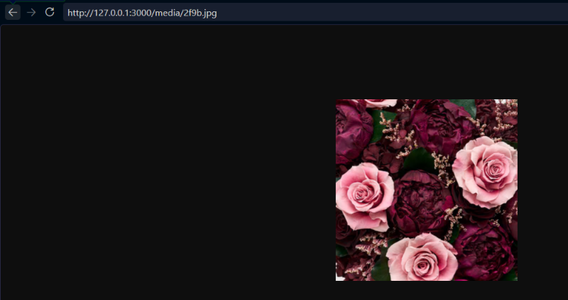
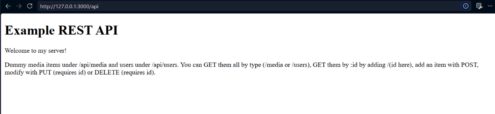
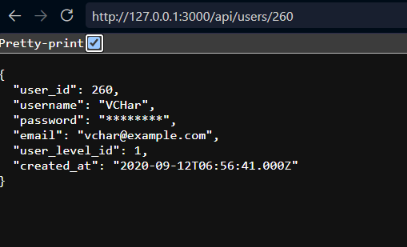
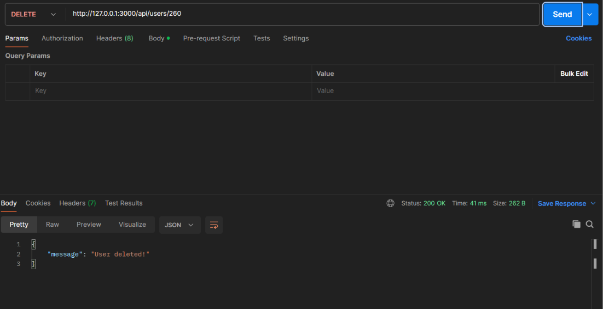

Sections 1-3 were done without issues in class on Tuesday.
Section 4 was done, however most of it is copied code, only slightly modified. For example: several 404 codes were changed to 204 codes, as the issue is not that the server is unable to access the appropriate array, but rather that there is no media item or user by the given id. Noted minor problem: Code functions completely fine, but noting to self to ask teacher about what exactly the code does in modifying the item. I recognize the utilization of extra operators of javascript, but they are still new enough I can't quite understand what's happening.
Section 5 was completed to the degree that you can look at the static file without issue, but it isn't yet served in response to a request to the media array
Section 6 was completed in users.js and media.js.

