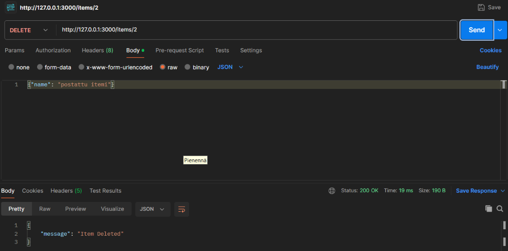
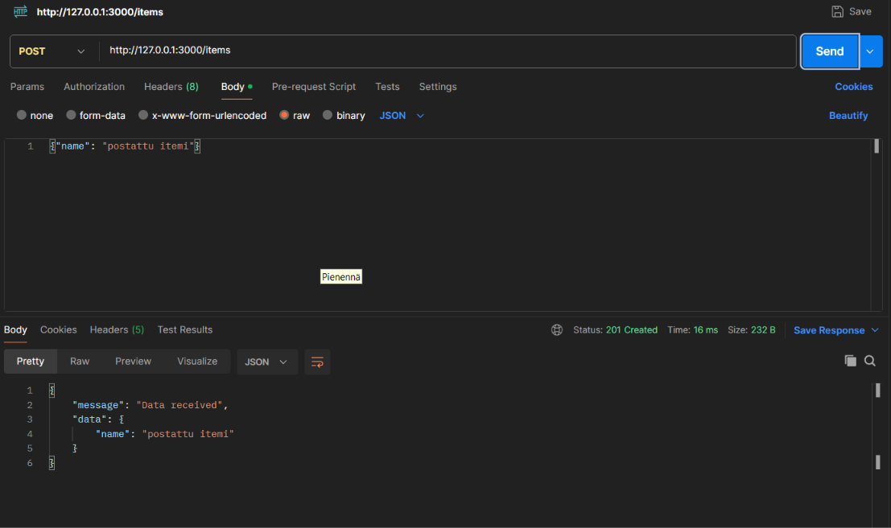
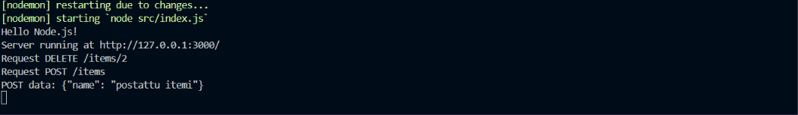
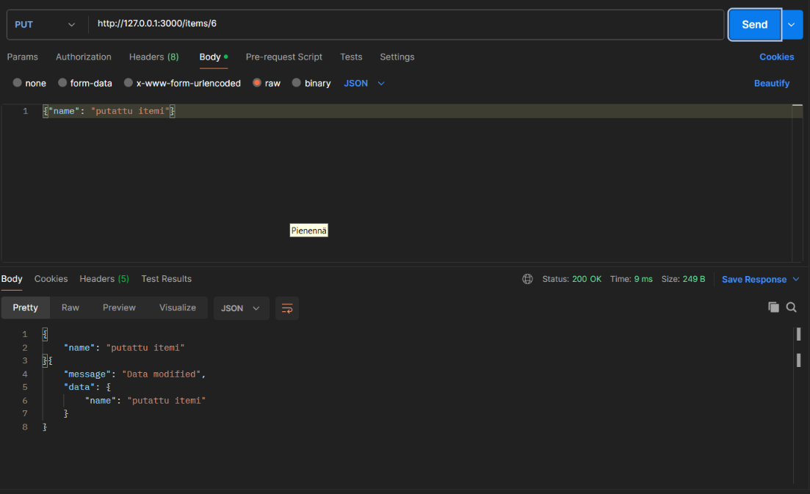

This testing dummy API lets you GET, POST, PUT and DELETE items from an object array

Endpoint || Method || Description || Request Body (Example) || Response Body (Example) || Status Codes

/ || GET || Welcoming page for the API || N/A || HTML page || 200 OK, 404 Not Found

/items || GET || Retrieve a list of all items || N/A || [{ "id": 1, "name": "Item1" }, { "id": 2, "name": "Item2" }] || 200 OK, 404 Not Found

/items || POST || Create a new item || { "name": "New Item" } || {"message": "Data received", "data": {"id": 3, "name": "New Item" }} || 201 Created, 400 Bad Request

/items/:id || GET || Retrieve details of a specific item by its ID || N/A || { "id": 1, "name": "Item1" } || 200 OK, 404 Not Found

/items/:id || PUT || Update details of a specific item by its ID || {"message": "Data modified", "data":{"id": id, "name": "Updated Item"}} || { "id": 1, "name": "Updated Item" } || 200 OK, 400 Bad Request, 404 Not Found

/items/:id || DELETE || Delete a specific item by its ID || N/A || {"message": "Item Deleted"} || 204 No Content, 404 Not Found

Of week 1's objectives, 1-6 were completed, though the degree to which 5 has been completed remains at the teacher's digression.
I couldn't get PUT to simply replace the item to be modified, but I could get it to modify the name correctly, and in the assingments objective 5, I'm uncertain how much I completed, as I couldn't quite understand what exactly "e.g. serve some real data, generate something of the data sent to the server" means in this context, as server side handling is so new.

